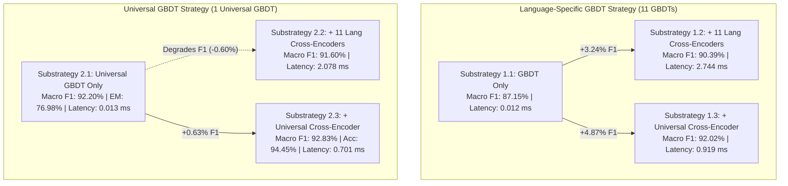
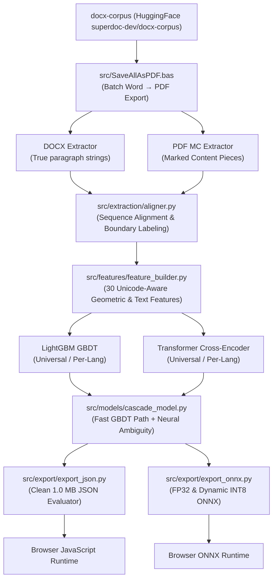

# Marked Content Text Joining (Multilingual Boundary Classification)

[](https://www.python.org/downloads/)
[](https://lightgbm.readthedocs.io/)
[](https://pytorch.org/)
[](https://huggingface.co/)
[](https://onnxruntime.ai/)

A machine learning and NLP pipeline for **automated marked content text joining and paragraph reconstruction** in PDF documents. 

---

## Table of Contents

1. [Problem Overview & Motivation](#problem-overview--motivation)
2. [Data Sources & External Downloads](#data-sources--external-downloads)
3. [Empirical Findings & Strategy Exploration](#empirical-findings--strategy-exploration)
4. [Architecture & Pipeline Overview](#architecture--pipeline-overview)
5. [Corpus Preparation & Word PDF Conversion (`SaveAllAsPDF.bas`)](#corpus-preparation--word-pdf-conversion-saveallaspdfbas)
6. [Command-Line Interface (`main.py`)](#unified-command-line-interface-mainpy)
   - [Benchmark Evaluation](#1-benchmark-evaluation)
   - [Model Export](#2-model-export)
   - [Interactive Inference (`predict`)](#3-interactive-inference)
   - [Model Training](#4-model-training)
   - [Dataset Construction](#5-dataset-construction)
   - [DOCX/PDF Single Document Alignment](#6-docxpdf-single-document-alignment)
   - [Language Manifest Generation](#7-language-manifest-generation)
7. [Web Demo](#interactive-multilingual-web-demo)
8. [Running Tests](#running-tests)

---

## Problem Overview & Motivation

Hybrid Books have a series of text segments that usually have paragraph-level granularity, so that users can click or tap any segment to view its synchronized video translation in a sign language (such as Libras) or listen to an audio reading of it.

However, modern PDF creation engines (Microsoft Word export, LaTeX, Adobe InDesign) emit text as fragmented Marked Content (`/MC`, `BDC`/`EMC`) chunks. Sentences and words are often split arbitrarily across bounding boxes due to line wraps, hyphenation, font changes, and styling.

| Ground Truth Intent | PDF Marked Content Input | Required Boundary Decision |
| :--- | :--- | :--- |
| Single paragraph sentence continuation across line break | Piece A: `"Perspectivas de gênero e sexualidade:"`<br>Piece B: `"uma análise qualitativa de evento científico"` | **JOIN (1)** |
| Bullet marker preceding item text | Piece A: `"•"`<br>Piece B: `"Requisitos Funcionais (RF)"` | **JOIN (1)** |
| Section heading transition into body text | Piece A: `"1. Introdução"`<br>Piece B: `"O objetivo deste trabalho é..."` | **SPLIT (0)** |
| Paragraph end followed by new paragraph | Piece A: `"Conclui-se que o modelo é viável."`<br>Piece B: `"Em trabalhos futuros..."` | **SPLIT (0)** |

---

## Data Sources & External Downloads

To reproduce the dataset extraction, training, or benchmarking from scratch, you will need the underlying document corpus and pretrained transformer checkpoints:

### 1. Document Corpus
- **HuggingFace Dataset**: [`superdoc-dev/docx-corpus`](https://huggingface.co/datasets/superdoc-dev/docx-corpus)
  - This dataset contains thousands of public `.docx` documents across various languages, types, and topics.
  - In our exploration we specifically filtered for documents with `type == 'educational'` and `topic == 'education'`, which appeared to be more useful for boundary classification and fit the more common use cases for our purposes. It is possible to use different filters or the entire corpus and retrain the models depending on your needs by passing custom `--types` and `--topics` to the [`manifest` CLI subcommand](#7-language-manifest-generation).
- **Pre-Filtered Manifests**: Included in [`manifests/`](manifests/) for all 11 target languages (`cs`, `de`, `en`, `es`, `fr`, `id`, `pl`, `pt`, `ru`, `tr`, `uk`). Each line corresponds to a document URL on `https://docxcorp.us/documents/<doc_hash>.docx`.
- **Word-to-PDF Conversion**: The ground truth relies on DOCXs internal semantic representation of the documents. The VBA macro [`src/SaveAllAsPDF.bas`](src/SaveAllAsPDF.bas) is provided to batch export the downloaded DOCX files to matching PDF files.

### 2. Pretrained Models & Architectures
- **Universal Cross-Encoder**: [`sentence-transformers/paraphrase-multilingual-MiniLM-L12-v2`](https://huggingface.co/sentence-transformers/paraphrase-multilingual-MiniLM-L12-v2) on HuggingFace Hub.
- **Language-Specific Transformer Checkpoints**:
  - Portuguese (`pt`): [`neuralmind/bert-base-portuguese-cased`](https://huggingface.co/neuralmind/bert-base-portuguese-cased)
  - English (`en`): [`sentence-transformers/all-MiniLM-L6-v2`](https://huggingface.co/sentence-transformers/all-MiniLM-L6-v2)
  - Russian (`ru`): [`cointegrated/rubert-tiny2`](https://huggingface.co/cointegrated/rubert-tiny2)
  - Spanish (`es`): [`dccuchile/bert-base-spanish-wwm-cased`](https://huggingface.co/dccuchile/bert-base-spanish-wwm-cased)
  - French (`fr`): [`almanach/camembert-base`](https://huggingface.co/almanach/camembert-base)
  - German (`de`): [`dbmdz/bert-base-german-cased`](https://huggingface.co/dbmdz/bert-base-german-cased)
  - Czech (`cs`): [`ufal/robeczech-base`](https://huggingface.co/ufal/robeczech-base)
  - Turkish (`tr`): [`dbmdz/bert-base-turkish-cased`](https://huggingface.co/dbmdz/bert-base-turkish-cased)
  - Polish (`pl`): [`allegro/herbert-base-cased`](https://huggingface.co/allegro/herbert-base-cased)
  - Ukrainian (`uk`): [`youscan/ukr-roberta-base`](https://huggingface.co/youscan/ukr-roberta-base)
  - Indonesian (`id`): [`indobenchmark/indobert-base-p1`](https://huggingface.co/indobenchmark/indobert-base-p1)

### 3. Pretrained GBDT Weights
- The pre-trained LightGBM GBDT models (including the production-ready universal model `gbdt_universal.pkl` and its browser-ready JSON export `gbdt_universal.json`) are under [`saved_models/multilingual/`](saved_models/multilingual/).
- In addition, minified browser-ready JSON dumps for all 11 individual language GBDTs and the universal model are included in [`src/export/web_demo/models/`](src/export/web_demo/models/).

---

## Empirical Findings & Strategy Exploration

During the multilingual exploration across **11 core languages** (`en`, `ru`, `es`, `tr`, `fr`, `cs`, `pt`, `de`, `pl`, `uk`, `id`) and **34,588 held-out test boundaries**, two primary strategies with three substrategies each were explored:



### Global Performance Matrix

| Strategy / Substrategy | Accuracy | Macro F1 | Join F1 | Split F1 | Phrase Exact Match (EM) | Latency / Pair | Footprint |
| :--- | :---: | :---: | :---: | :---: | :---: | :---: | :---: |
| **Heuristic Baseline** | 77.05% | 59.57% | 86.16% | 32.98% | 9.25% | <0.001 ms | 0 MB (excluding code) |
| **1.1 Language-Specific GBDTs Only** | 89.28% | 87.15% | 92.39% | 81.91% | 72.61% | 0.012 ms | 13.3 MB (11 files) |
| **1.2 Specific GBDTs + 11 Lang Encoders** | 92.33% | 90.39% | 94.70% | 86.08% | 72.45% | 2.744 ms | ~4.8 GB (11 transformers) |
| **1.3 Specific GBDTs + Universal Encoder** | 93.81% | 92.02% | 95.83% | 88.22% | 73.22% | 0.919 ms | 485 MB |
| **2.1 Universal GBDT Only (`gbdt_universal.pkl`)** | **93.82%** | **92.20%** | **95.75%** | **88.64%** | **76.98%** | **0.013 ms** | **1.21 MB (1 file)** |
| **2.2 Universal GBDT + 11 Lang Encoders** | 93.32% | 91.60% | 95.40% | 87.80% | 74.98% | 2.078 ms | ~4.8 GB |
| **2.3 Universal GBDT + Universal Encoder** | **94.45%** | **92.83%** | **96.24%** | **89.43%** | **75.06%** | **0.701 ms** | **472 MB** |

### Key Architectural Takeaways

1. **Universal GBDT is the production champion for client-side execution**: At **1.0 MB** and **0.013 ms** per boundary, the Universal GBDT achieves **92.20% Macro F1** and the highest **Phrase Exact Match (76.98%)** with zero external dependencies.
2. **Universal Cross-Encoder decisively beats 11 Language-Specific Cross-Encoders**: Monolingual cross-encoders suffered from the "specialization trap" (over-indexing on vocabulary quirks in small monolingual pools). Fine-tuning a single universal cross-encoder (`sentence-transformers/paraphrase-multilingual-MiniLM-L12-v2`) enabled cross-lingual layout and semantic transfer across all languages.
3. **2-Stage Cascade**: GBDT handles unambiguous decisions ($P \ge 0.90$ for JOIN, $P \le 0.10$ for SPLIT) in $\approx 13\ \mu\text{s}$. Ambiguous cases are routed to neural inference, achieving **94.45% accuracy** at sub-millisecond average latency.

---

## Architecture & Pipeline Overview



---

## Corpus Preparation & Word PDF Conversion (`SaveAllAsPDF.bas`)

Ground truth boundary datasets are generated by pairing DOCX documents with their Word-exported PDFs. The script [`src/SaveAllAsPDF.bas`](src/SaveAllAsPDF.bas) is a Microsoft Word VBA macro designed for reliable batch conversion.

### How to Run `SaveAllAsPDF.bas` in Word:
1. Open Microsoft Word.
2. Press `Alt + F11` to open the VBA Editor.
3. Click **File > Import File...** (or press `Ctrl + M`) and select [`src/SaveAllAsPDF.bas`](src/SaveAllAsPDF.bas).
4. Place your cursor inside `Sub SaveAllAsPDF()` and press `F5` (or click **Run Sub/UserForm**).
5. Choose your source DOCX folder and destination PDF folder.
6. A summary dialogue displays total converted, skipped, and failed documents upon completion.

---

## Command-Line Interface (`main.py`)

### 1. Benchmark Evaluation

Runs the comparative evaluation across all 6 substrategies and 11 languages, outputting the complete Macro F1 matrix and global performance tables:

```bash
python main.py benchmark
```

Optional arguments:
```bash
python main.py benchmark \
  --data-dir data/multilingual \
  --models-dir saved_models/multilingual \
  --results-dir results/multilingual
```

### 2. Model Export

Exports trained models into clean, lightweight client-side formats:

```bash
# Export Universal GBDT to clean, minified JSON (for TypeScript/JavaScript runtime)
python main.py export --target json

# Export GBDT to formatted (pretty) JSON with custom output path
python main.py export --target json --model saved_models/multilingual/gbdt_universal.pkl --output saved_models/multilingual/gbdt_universal.json --pretty

# Export Cross-Encoder to ONNX with INT8 dynamic quantization
python main.py export --target onnx --output src/export/web_demo

# Export all web assets (GBDT JSON + ONNX FP32/INT8 + Tokenizer)
python main.py export --target web-demo
```

You can also run the dedicated exporter directly:
```bash
python -m src.export.export_json -i saved_models/multilingual/gbdt_universal.pkl -o saved_models/multilingual/gbdt_universal.json
```

### 3. Interactive Inference

Quickly test a boundary decision between two text snippets:

```bash
python main.py predict \
  --text-a "Perspectivas de gênero e sexualidade:" \
  --text-b "uma análise qualitativa de evento científico" \
  --dy 2.0
```

Output:
```
============================================================
BOUNDARY PREDICTION RESULT
============================================================
Piece A:  "Perspectivas de gênero e sexualidade:"
Piece B:  "uma análise qualitativa de evento científico"
Decision: JOIN
P(JOIN):  73.14%  |  P(SPLIT): 26.86%
Model:    saved_models\multilingual\gbdt_universal.pkl
============================================================
```

### 4. Model Training

Train any or all models across strategies:

```bash
# Train the Universal Multilingual GBDT (LightGBM on pooled multi-lingual boundaries)
python main.py train --strategy universal-gbdt

# Train 11 language-specific GBDTs
python main.py train --strategy lang-gbdts

# Train a single language GBDT (e.g. Portuguese)
python main.py train --strategy lang-gbdts --lang pt

# Fine-tune the Universal Cross-Encoder (MiniLM-L12 on CUDA)
python main.py train --strategy universal-encoder --epochs 2 --batch-size 32

# Fine-tune all 11 language-specific Cross-Encoders
python main.py train --strategy lang-encoders --epochs 2 --batch-size 16

# Train all models across both strategies
python main.py train --strategy all
```

### 5. Dataset Construction

Extract aligned marked content boundaries across target languages into document-level train/val/test splits:

```bash
python main.py build-dataset \
  --manifest-dir manifests \
  --docx-dir "path/to/docx-corpus" \
  --pdf-dir "path/to/converted-PDFs" \
  --output-dir data/multilingual \
  --train-docs 60 \
  --val-docs 10 \
  --test-docs 15 \
  --seed 42
```

### 6. DOCX/PDF Single Document Alignment

Align a single DOCX and PDF document to inspect extracted pieces and boundary labels:

```bash
python main.py align \
  --docx "path/to/sample.docx" \
  --pdf "path/to/sample.pdf" \
  --output sample_boundaries.json
```

### 7. Language Manifest Generation

Scan converted PDFs against the HuggingFace `superdoc-dev/docx-corpus` index and generate per-language manifest lists. By default, documents are filtered for `educational` type and `education` topic. You can pass a custom list of types and topics, or disable filtering to use the entire corpus:

#### Default Filter (Educational / Education)
When `--types` and `--topics` are unspecified, the CLI defaults to `type == 'educational'` and `topic == 'education'`:
```bash
python main.py manifest \
  --docx-dir "path/to/docx-corpus-educational-education" \
  --pdf-dir "path/to/converted-PDFs" \
  --output-dir manifests
```

#### Custom Type & Topic Subsets
Pass one or more types and topics as space-separated lists or comma-separated strings:
```bash
# Space-separated list of types and topics
python main.py manifest \
  --docx-dir "path/to/docx-corpus" \
  --pdf-dir "path/to/converted-PDFs" \
  --types educational academic government \
  --topics education science politics \
  --output-dir manifests

# Or comma-separated format
python main.py manifest \
  --types educational,academic \
  --topics education,science
```

#### Entire Corpus (No Filtering)
To include all documents regardless of type or topic across the target languages, pass `all` or use the `--all` flag:
```bash
# Using the --all flag
python main.py manifest \
  --all \
  --docx-dir "path/to/docx-corpus" \
  --pdf-dir "path/to/converted-PDFs" \
  --output-dir manifests

# Or using the 'all' keyword
python main.py manifest --types all --topics all

# Or selectively omitting filters (e.g. all topics for educational type)
python main.py manifest --types educational --topics all
```

**Manifest CLI Options**:
- `--types [TYPES ...]`: List of document types to include (space-separated or comma-separated). Default: `educational`. Pass `all` to disable type filtering.
- `--topics [TOPICS ...]`: List of document topics to include (space-separated or comma-separated). Default: `education`. Pass `all` to disable topic filtering.
- `--all-types`: Disable type filtering (include all document types).
- `--all-topics`: Disable topic filtering (include all document topics).
- `--all`: Disable both type and topic filtering (use entire corpus).
- `--languages`: Comma-separated language codes to include (e.g. `en,pt,es`). Default: all 11 target languages.

---

## Web Demo

There is an in-browser demo located at [`src/export/web_demo/`](src/export/web_demo/). It allows live exploration and comparison of the **6 machine learning strategies** and the **heuristic baseline** across all **11 supported languages**.

### Features:
1. **All 7 Strategies Implemented**:
   - **Heuristic Baseline**: Zero ML rule baseline (59.57% Global Macro F1).
   - **Substrategy 1.1**: Language-Specific GBDT Only (87.15% Global Macro F1).
   - **Substrategy 1.2**: Language GBDT + 11 Language Cross-Encoders (90.39% Global Macro F1).
   - **Substrategy 1.3**: Language GBDT + Universal Cross-Encoder (92.02% Global Macro F1).
   - **Substrategy 2.1**: Universal GBDT Only: Production Champion (92.20% Global Macro F1, 13 µs latency, 1.0 MB model).
   - **Substrategy 2.2**: Universal GBDT + 11 Language Cross-Encoders (91.60% Global Macro F1).
   - **Substrategy 2.3**: Universal GBDT + Universal Cross-Encoder (92.83% Global Macro F1, 94.45% Accuracy).
2. **11 Supported Languages**: Switch between `pt`, `en`, `es`, `cs`, `ru`, `de`, `fr`, `id`, `pl`, `tr`, and `uk`. The UI dynamically loads the dedicated language GBDT model or universal model as selected.
3. **Multilingual Sample Documents**: Includes pre-built educational samples for Portuguese, English, Spanish, Czech, and Russian with realistic bounding boxes, headers, lists, and multi-line paragraph wraps.
4. **Live Empirical Performance Card**: Displays the exact held-out test split Macro F1 (both globally and for the selected language), exact match, accuracy, latency, and architectural notes loaded from `benchmark_matrix.json`.
5. **Interactive Routing Breakdown**: For 2-stage cascades, visualizes whether each boundary was resolved in **Stage 1 Fast Path** ($\le 13\ \mu\text{s}$) or routed to **Stage 2 Neural Arbiter**.

### Running the Web Demo:
To launch the demo locally:
```bash
# Serve the web demo directory using Python's built-in HTTP server:
python -m http.server 8080 --directory src/export/web_demo
```
Then navigate to `http://localhost:8080` in your web browser.

---

## Running Tests

Unit and integration tests cover feature engineering, Unicode support, pipeline alignment, and model export schema validation:

```bash
# Run all unit tests
python -m unittest discover -s tests

# Or run specific test suites
python -m unittest discover -s tests -p "test_features_unicode.py"
python -m unittest discover -s tests -p "test_pipeline.py"
python -m unittest discover -s tests -p "test_export.py"
```
